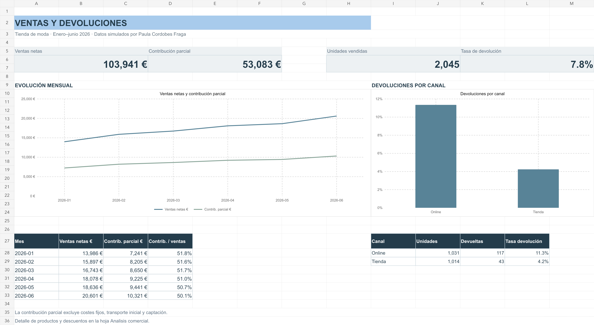

# Retail Lab — Ventas & Customer Experience

**Microsoft Excel · Análisis comercial · Retail · Promociones**

Un caso práctico para responder a una pregunta comercial: **¿cómo comparar ventas, descuentos y devoluciones antes de decidir una promoción?**

[Descargar Excel](https://github.com/PaulaCordobesFraga/Retail-Lab-Excel/raw/refs/heads/main/Retail-Lab-Excel.xlsx) · [Portfolio de Paula Cordobes Fraga](https://paulacordobesfraga.github.io/)

## El caso

Una tienda ficticia de moda con **1.500 pedidos simulados**, registrados entre enero y junio de 2026, combina los canales online y tienda. El análisis conecta ventas y devoluciones con la contribución parcial y el volumen necesario para sostener una promoción.

## Qué incluye

| Hoja | Pregunta de negocio | Contenido |
| :--- | :--- | :--- |
| Resumen | ¿Cómo evoluciona el negocio? | Indicadores, tendencia mensual y devoluciones por canal |
| Promocion | ¿Cuánto habría que vender con descuento? | Entradas editables y umbral de unidades para mantener la contribución |
| Pedidos | ¿De dónde salen los indicadores? | 1.500 pedidos, filtros y cálculos por operación |
| Analisis comercial | ¿Qué cambia por categoría, canal y descuento? | Comparaciones, tablas y gráficos vinculados a celdas |

**Cuatro hojas · siete gráficos · cinco tablas con filtros.**

## Cómo utilizarlo

1. Descarga el archivo y ábrelo en Microsoft Excel.
2. Empieza por **Resumen** para revisar los indicadores y la evolución mensual.
3. Consulta **Analisis comercial** y filtra **Pedidos** para explorar los segmentos.
4. En **Promocion**, modifica precio, coste, descuento y unidades de referencia para comparar escenarios.

## Método

- **Ventas netas:** unidades no devueltas × precio × (1 − descuento).
- **Contribución parcial:** ventas netas − coste de las unidades no devueltas − coste de gestionar devoluciones.
- **Tasa de devolución:** unidades devueltas / unidades vendidas.
- **Umbral de promoción:** unidades necesarias para mantener la contribución de referencia, redondeadas al alza.

El análisis usa cohortes cerradas y supone que se recupera el inventario devuelto. La contribución no incorpora costes fijos, envío inicial, adquisición de clientes ni impuestos.

## Relación con marketing y experiencia de cliente

La comparación entre canal online y tienda permite plantear preguntas sobre información de producto, expectativas del cliente y promociones. Es una base de análisis comercial para formular hipótesis; no contiene datos de inversión publicitaria, atribución, conversión web o campañas reales y, por tanto, no calcula su ROI ni ROAS.

## Contexto formativo

Relacionado con la formación en **Excel de Santander Open Academy** y las áreas de **Retail & Customer Experience de INSIDE LVMH**. La orientación al cliente conecta con la metodología **Inbound de HubSpot Academy**.

## Alcance de los datos

Proyecto independiente con datos simulados. Los resultados describen el caso ficticio y no representan ventas de una empresa real. El simulador calcula un umbral contable, no una previsión de demanda.
